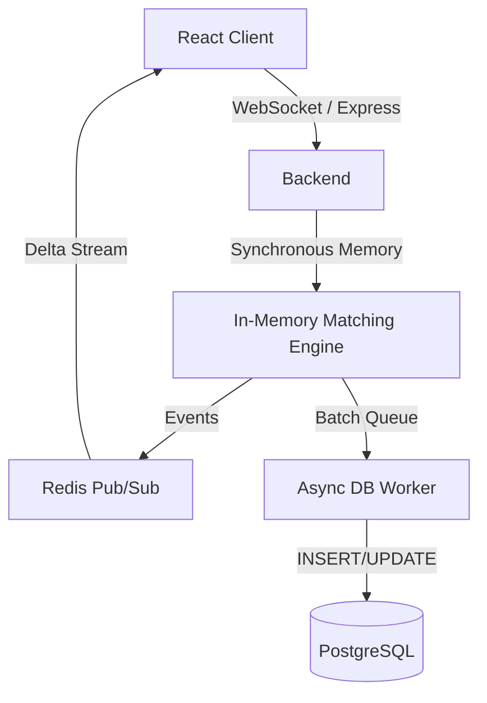

# TradeForge

A production-grade, full-stack real-time trading platform and order-matching engine.

## Architecture

## Core Systems Design

1. **In-Memory Matching Engine**: Enforces strict Price-Time Priority (FIFO) locally. Kept single-threaded to eliminate context switching, easily exceeding 10,000+ orders/sec. Orders map via hash-table for O(1) cancellation.
2. **Async Write-Behind Persistence**: The matching hot-path never awaits database I/O. Trades and state mutations are queued and periodically flushed via batched multi-row transactions (`INSERT ... ON CONFLICT`). This solves the traditional row-locking bottleneck in RDBMS trading setups.
3. **Delta Streaming**: Redis Pub/Sub acts as a scalable message bus for L2 deltas and trade tapes, broadcast to clients via scalable Socket.io gateways.

## Getting Started

1. Ensure Docker and Docker Compose are installed.
2. Run `docker-compose up --build -d`
3. Access Frontend at `http://localhost:80` (or the mapped port).
4. Backend API running at `http://localhost:3000`.

## Benchmarking

To test engine limits:

1. Stop standard backend to free port (or change benchmark port logic).
2. Run `cd backend && npm run start &`
3. Run `cd backend && npm run benchmark`

This outputs ops/sec for throughput and p99 latency stats across 500 simulated concurrent websockets.
